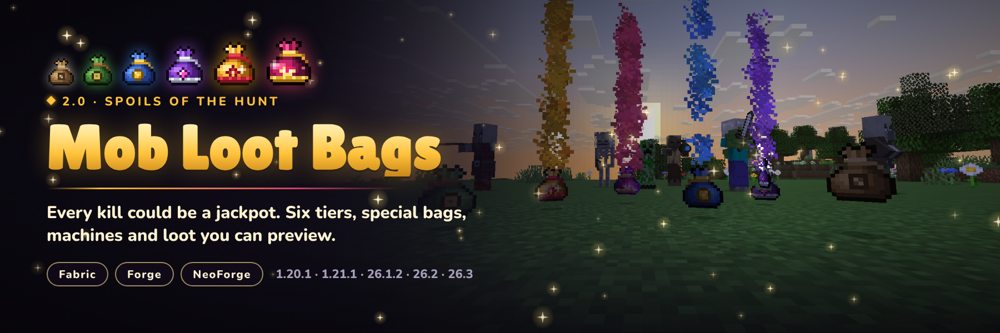

# Mob Loot Bags



Mobs drop loot bags in six tiers, from Common to Mythic. Hold to open them, preview what's inside, automate them
with the Bag Opener, grind mob-farm junk into new bags with the Loot Recycler, and gamble on Cursed, Hourglass and
Locked bags. Every drop rate, loot table and machine value is data-driven.

**2.0 "Spoils of the Hunt"** is a full rework: see the [2.0.0 notes](patchnotes/2.0.0.md).

## Which jar do I download?

Jar names are `mob_loot_bags-{loader}-{minecraft}-{modVersion}.jar`. Match **both** the Minecraft version and the loader.

| Minecraft | Java | Fabric jar (needs Fabric API) | NeoForge / Forge jar |
|-----------|------|-------------------------------|----------------------|
| 1.20.1 | 17+ | `…-fabric-1.20.1-….jar` | `…-neoforge-1.20.1-….jar` (a **Forge** 47 jar despite the name) |
| 1.21.1 | 21+ | `…-fabric-1.21.1-….jar` | `…-neoforge-1.21.1-….jar` |
| 26.1.2 | 25+ | `…-fabric-26.1.2-….jar` | `…-neoforge-26.1.2-….jar` |
| 26.2 | 25+ | `…-fabric-26.2-….jar` | `…-neoforge-26.2-….jar` |
| 26.3 | 25+ | `…-fabric-26.3-….jar` | `…-neoforge-26.3-….jar` |

`26.1.2`, `26.2` and `26.3` are separate game versions from 1.21.1 and need Java 25+. If a download page lists a
`*-26.1.2-*.jar` under a 1.21.1 filter, that file still needs Minecraft 26.1.2: check the file name before installing.

The mod is needed on both the server and the client.

## Features

- **Six tiers**: Common, Uncommon, Rare, Epic, Legendary and the new Mythic. Craft four bags into one of the next
  tier, or split one back into four.
- **Smarter drops**: an 18% base chance that scales with the mob's health, Bag Luck from Looting, Luck, mob health,
  the Nether, the End and Hard difficulty, bad-luck protection, boss drops (three Epic+ bags), bag-carrying mobs,
  a spawner penalty for farms, and themed Nether/End loot.
- **Opening**: hold Use to open (sneak for the whole stack), loot straight to the inventory, a reveal toast, titles
  and fanfares for Legendary and Mythic bags, Shift loot previews from the real loot tables, and loot beams on
  dropped bags.
- **Special bags**: Cursed (ambush, jackpot, hex or chaos), Hourglass (ripens into better bags), Locked (needs a
  Diamond Key) and Summoning (spawn eggs). The Fortune Talisman makes bags likelier and better.
- **Machines**: the Bag Opener (9 in / 18 out, four redstone modes, hopper I/O, comparator) and the Loot Recycler
  (junk to bags, bags to stored experience).
- **Progression**: 13 advancements, bag statistics and recipe unlocks.
- **For modpacks**: commented configs, datapack-overridable tables, `#mob_loot_bags:bonus/<tier>` item tags,
  per-mob multipliers, whitelist/blacklist, and `/lootbags` commands to test it all.

## Installation

1. Install Fabric (with Fabric API) or NeoForge (Forge on 1.20.1) for your Minecraft version.
2. Download the matching jar from [Modrinth](https://modrinth.com/mod/mob-loot-bags/versions) or
   [CurseForge](https://www.curseforge.com/minecraft/mc-mods/mob-loot-bags) using the table above.
3. Put it in your `mods` folder (on the server and on every client).

## Configuration

On first launch the mod writes four commented files to `config/mob_loot_bags/`. Each value is explained in the file;
missing keys are restored with their defaults, and `/lootbags reload` applies changes without a restart.

| File | What it controls |
|------|------------------|
| `drops.json` | Drop chances, health scaling, tier weights, Bag Luck, special bag odds, themes, bad-luck protection, bosses, bag carriers, announcements, per-mob multipliers, mob filter |
| `bags.json` | Opening (hold time, stacks, toasts, titles), loot table overrides per bag, Cursed outcomes, Hourglass timing, Locked bag key, previews |
| `machines.json` | Bag Opener speed, Loot Recycler speed, points per bag, junk values and bag experience |
| `client.json` | Loot beams, reveal toast and preview tooltips (client only) |

### Loot tables and datapacks

- Each bag rolls `mob_loot_bags:bags/<bag>`; a datapack can replace any of them.
- Bags dropped in a dimension roll `mob_loot_bags:bags/<tier>/<dimension path>` when that table exists
  (the mod ships `the_nether` and `the_end`; add your own for modded dimensions).
- `bags.json` → `loot_tables` can point a bag at your own tables (several = one picked at random).
- Add items to `#mob_loot_bags:bonus/<tier>` to mix them into a tier without writing a table.
- [`templates/loot_tables_template.zip`](templates/loot_tables_template.zip) holds a starter datapack for every
  supported version.

### Commands

`/lootbags` (alias `/mlb`):

| Command | Who | What it does |
|---------|-----|--------------|
| `give <players> <bag> [count] [theme]` | ops | Gives bags (`common` … `mythic`, `cursed`, `hourglass`, `locked`, `summoning`) |
| `simulate <bag> [bags] [theme]` | ops | Opens a bag's table up to 10,000 times and lists each item's chance |
| `odds [mob]` | everyone | Shows a mob's drop chance and tier odds with your Bag Luck |
| `stats [player]` | everyone (others: ops) | Bags found and opened per tier, and bad-luck counters |
| `reload` | ops | Reloads the config files |

## Upgrading from 1.x

Item and block IDs are unchanged, so existing bags and machines stay in your world. Timed bags become Hourglass
bags, old machines are rearranged into the new slot layout, and customised settings in `config/mlb/` (drop rates,
whitelist/blacklist, cursed events, custom loot tables, recycler values) are copied into the new files once.

## Building

Each Minecraft version is a separate MultiLoader Gradle workspace (`common/`, `fabric/` and a NeoForge/Forge
project in `neoforge/`). Gradle needs the workspace's Java version: 17 for 1.20.1, 21 for 1.21.1, 25 for 26.x.

```bash
cd 1.21.1
./gradlew build          # jars in fabric/build/libs and neoforge/build/libs
./gradlew :common:test   # tier-odds and config-file unit tests
```

Prebuilt release jars go in `releases/` for the publish workflow. Publish metadata is derived from the jar
**filename** (see `.github/scripts/detect-jar-meta.js`); run `node .github/scripts/detect-jar-meta.test.js` to
verify it. Release notes for a version live in `patchnotes/<version>.md`.

## Tools

- [`tools/assets/`](tools/assets): generates every texture, GUI, sound, model, blockstate, language file, loot
  table, recipe, tag and advancement for each Minecraft version from one source
  (`python3 tools/assets/build.py <version|all>`), plus the datapack template (`python3 tools/assets/template.py`).
- [`tools/qa/`](tools/qa): runs dev servers and a real game client under Xvfb. `server_smoke.py` checks drops,
  loot tables, machines, commands and reloads over RCON; `client_checks.py` checks opening, special bags,
  migration, machine screens and spawner tagging in game.
- [`marketing/`](marketing): the CurseForge/Modrinth description, listing images and how to regenerate them.

## Links

- [Discord](https://discord.gg/SAmd9fhNhr)
- [Modrinth](https://modrinth.com/mod/mob-loot-bags/versions)
- [CurseForge](https://www.curseforge.com/minecraft/mc-mods/mob-loot-bags)
- [Docs](https://meherbensalem.github.io/pages/mods.html)
- [Ko-fi](https://ko-fi.com/nightbeamstudio)

## Contributing

See [CONTRIBUTING.md](CONTRIBUTING.md). Please follow the [Code of Conduct](CODE_OF_CONDUCT.md).

## Security

See [.github/SECURITY.md](.github/SECURITY.md).

## License

Licensed under the [Apache License, Version 2.0](LICENSE).
See [NOTICE](NOTICE) for copyright attribution.
